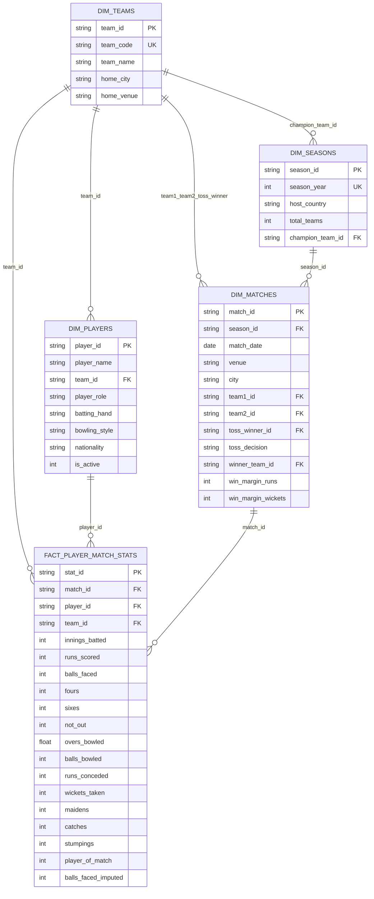

# Star Schema ER Diagram & Draw.io Guide — Project #21

## 1. Star Schema Mermaid ER Diagram

---

## 2. Step-by-Step Instructions to Draw in draw.io
1. Open [app.diagrams.net](https://app.diagrams.net) and create a blank diagram (`IPL_Star_Schema.drawio`).
2. In the left panel, enable **Entity Relation** shapes (`More Shapes -> Software -> Entity Relation`).
3. Drag **5 Table boxes** onto the canvas:
   - Place **`fact_player_match_stats`** in the **center** (highlight header in Navy `#1F4E78`).
   - Place the 4 dimensions around it in a star layout: **`dim_players`** (left), **`dim_matches`** (top), **`dim_teams`** (right), and **`dim_seasons`** (top-right).
4. Add columns inside each table box and mark **`PK`** (Primary Key) and **`FK`** (Foreign Key) on the left column slot.
5. Connect relationships using **Crow's Foot** connectors (`1` on the Dimension side, `0..N` / Many on the Fact side):
   - `dim_players.player_id` (1) ---> (*) `fact_player_match_stats.player_id`
   - `dim_matches.match_id` (1) ---> (*) `fact_player_match_stats.match_id`
   - `dim_teams.team_id` (1) ---> (*) `fact_player_match_stats.team_id`
   - `dim_seasons.season_id` (1) ---> (*) `dim_matches.season_id`
   - `dim_teams.team_id` (1) ---> (*) `dim_players.team_id`
6. Export via **File -> Export as -> PNG / PDF** to include in your report or presentation.
